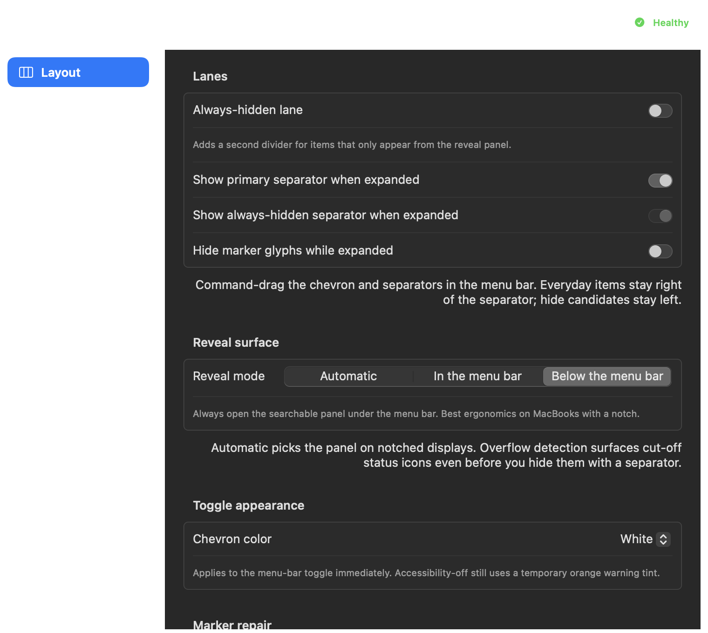

# Nicos Hidden Bar

[](https://github.com/nstranquist/nicos-hidden-menubar/actions/workflows/ci.yml)

A native macOS menu-bar organizer for hiding the status items you do not need
all the time. It is local-first, has no account or network service, and is built
with Swift, AppKit, and SwiftUI.


The app provides three regions—visible, hidden, and optionally always hidden—
with a compact chevron in the menu bar to reveal or collapse them. A searchable
floating panel provides a notch-safe way to reach hidden items on modern
MacBooks.



Extra captures go in [screenshots/](screenshots/).

## Highlights

- Native menu-bar app with no Dock icon during normal use
- Visible, hidden, and always-hidden regions
- **Notch support (on by default):** detect status items under the laptop camera
  width and list them in an **Overflow** section of the reveal panel;
  ⌘-drag to reorder, unhide into the menu bar, or park into the hidden lane
- Auto-collapse profiles for focus, presenting, and recording
- Optional global keyboard shortcut, off by default (`Ctrl+Option+Command+M`)
- Searchable hidden-items panel with text fallback
- Automatic below-menu-bar reveal on notched displays
- Per-display panel sizing with live display-change handling
- Optional import of existing Hidden Bar preferences
- Optional experimental item movement behind an explicit safety toggle
- JSON configuration and diagnostics that stay on your Mac

## Requirements

- macOS 14 Sonoma or newer
- Apple Silicon or Intel Mac supported by the Swift 6 toolchain
- Xcode Command Line Tools for source builds

## Install from source

```bash
git clone https://github.com/nstranquist/nicos-hidden-menubar.git
cd nicos-hidden-menubar
make install
```

`make install` builds a release app and signs with a **stable identity** when
available (Apple Development from your keychain so Accessibility survives
rebuilds). Ad-hoc is only the fallback when no cert is found. Install path:
`/Applications/NicosHiddenMenuBar.app`.

```bash
make install-stable   # first time / after ad-hoc: reset AX TCC + open Privacy
make print-identity   # show which codesign identity will be used
# optional distribution:
DEVELOPER_ID_IDENTITY="Developer ID Application: …" make notarize
```

Launch at login is managed from Settings using macOS Service Management.

To remove the app, first disable **Launch at login** in Settings, then run:

```bash
make uninstall
```

## First-run setup

1. Find the chevron and separator markers in the menu bar.
2. Hold Command and drag menu-bar items into the desired regions.
3. Keep frequently used items to the right of the primary separator.
4. Put items you want to collapse to the left of the primary separator.
5. Enable the optional always-hidden region if you want a second boundary.
6. Choose **Automatic**, **In the menu bar**, or **Below the menu bar** in
   Settings, then click the chevron to verify the reveal behavior.

Option-click the chevron to temporarily reveal the marker controls. Right-click
it to open Settings, Diagnostics, the hidden-items panel, or Quit.

## Permissions

| Permission | Required | Used for |
|---|---:|---|
| Accessibility | Recommended | Opening hidden items from the panel; experimental item movement; Control Center labels via AX |
| Screen Recording | Optional | Live pixel icons of menu-bar items in the panel |

Basic marker-based collapse and reveal work without either permission.

- **Accessibility:** Settings → **Permissions** → **Add to Privacy Settings…**, then enable
  **Nicos Hidden Bar** under System Settings → Privacy & Security → Accessibility.
  Also: `open nicoshiddenbar://privacy`
- **Screen Recording:** same Permissions section for live icons. Without it, the panel
  shows SF Symbols (Control Center modules) and app icons as fallbacks.

## Configuration

User state is stored under:

```text
~/.config/nicos-hidden-menubar/config.json
~/.config/nicos-hidden-menubar/diagnostics.json
~/.config/nicos-hidden-menubar/hammerspoon-bridge.json
```

The Hammerspoon bridge is advisory. The app's JSON configuration remains the
source of truth when they disagree.

The URL scheme can be used by Shortcuts, Hammerspoon, or shell automation:

```text
nicoshiddenbar://toggle
nicoshiddenbar://expand
nicoshiddenbar://collapse
nicoshiddenbar://reveal-panel
nicoshiddenbar://open/settings
nicoshiddenbar://open/diagnostics
nicoshiddenbar://profile/focus
```

## Development

```bash
swift test
make build
make format-check
make perf-check PERF_ALLOW_UI_AUTOMATION=true  # visibly cycles the panel
make headless-smoke
make run
```

Project architecture, decisions, active requirements, quality matrices, and
release evidence are indexed in [`docs/INDEX.md`](docs/INDEX.md).
Validate their links and evidence contract with `make docs-check`.

The headless smoke opens and captures the real settings window off-screen while
asserting that the app never steals focus. Reports and screenshots are written
under `.local/headless-smoke/` and are ignored by Git.

Local verification (2026-08-12): `swift test` reports **162** package tests green.
Run `make verify-publication && make headless-smoke` before release. The
reviewed repository screenshot above is copied from that smoke output and
contains no account, menu-bar, or other private user data.
`make release-artifact` additionally creates a versioned ZIP, SHA-256 digest,
and provenance receipt under `.local/release/`; the receipt remains explicitly
not distribution-ready until Developer ID signing and notarization are present.
The performance command is deliberately confirmation-gated because it restarts
the app and visibly opens/dismisses the panel; notify the active Mac user first.

## Architecture and tradeoffs

The app owns AppKit `NSStatusItem` controls and uses their persisted positions
as section boundaries. SwiftUI owns Settings, Onboarding, Profiles, and
Diagnostics. Notch-aware discovery reads menu-item window frames through private
CoreGraphics window-server symbols; this makes the app appropriate for direct,
open-source distribution rather than the sandboxed Mac App Store.

Display topology and resolution changes are handled through macOS notifications,
without a background polling loop. The reveal panel is sized and clamped to the
display containing the status item. Closing it cancels active work while retaining
only the bounded identity-keyed cache needed for a fast warm reveal; memory
pressure clears that cache.

Experimental movement synthesizes the same Command-drag interaction a user can
perform manually. It remains off by default because third-party menu items can
respond at different speeds. Automatic collapse uses the same verified
marker-and-spacer mechanism on regular and notched displays. The below-menu-bar
panel is the notch-safe access surface: it lets you search, activate, or
explicitly unhide items without consuming permanent menu-bar space. A collapse
that cannot be verified remains expanded instead of moving third-party items
automatically.

No configuration, diagnostics, screenshots, or telemetry leave the machine.

## License and provenance

Nicos Hidden Bar is released under the GNU General Public License v3.0. Parts of
its menu-bar discovery and movement design are adapted from
[Ice](https://github.com/jordanbaird/Ice), also GPL-3.0. See [NOTICE](NOTICE) for
attribution and [LICENSE](LICENSE) for the complete terms.

Security reporting: [SECURITY.md](SECURITY.md). Changes: [CHANGELOG.md](CHANGELOG.md).
